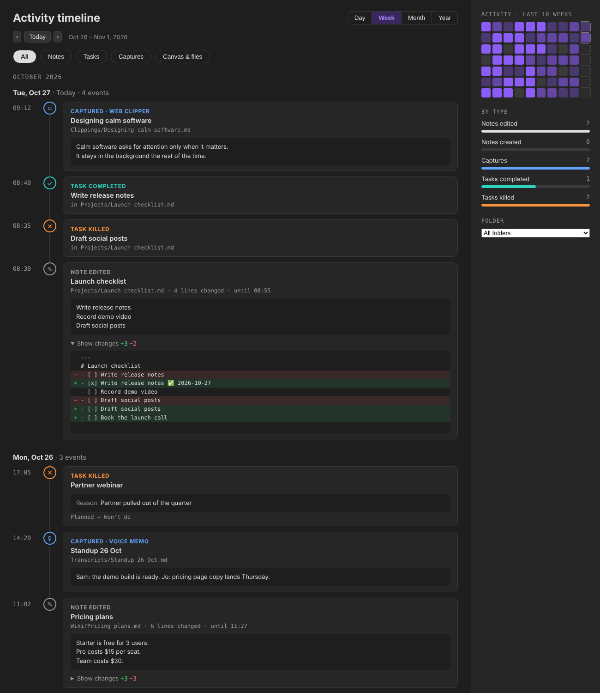
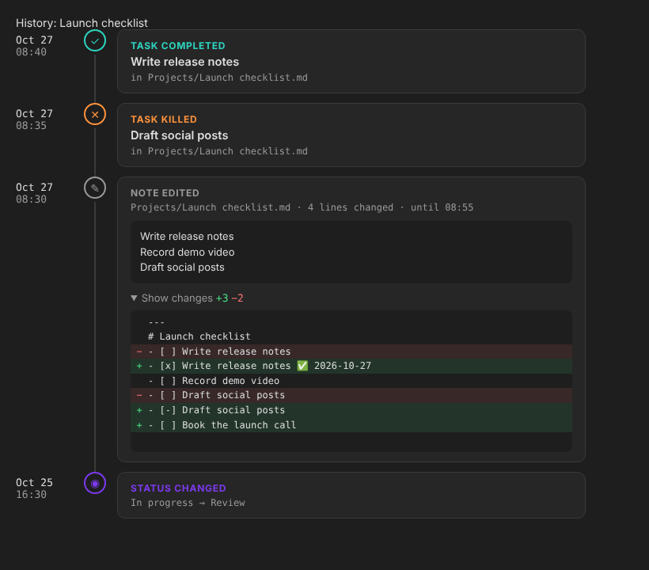

# Magpie

An activity timeline for your Obsidian vault. Magpie records what you create, edit, capture and finish, and keeps the exact lines that changed, so you can look back at any day or any note and see what you did.



## Open it

- Click the **bird icon** in the left ribbon, or run **Magpie: Open activity timeline**.
- In any note, click the **history icon** next to the edit button at the top right to see that note's history. You can also use **Show history** in the file menu, or the command **Magpie: Show history of this note**.

## The timeline

- **Day / Week / Month / Year** switches the period. The arrows and **Today** move through it.
- **Chips** filter by type: Notes, Tasks, Captures, Canvas & files.
- **Sidebar**: a heatmap of the last 10 weeks (click a day to open it), counts by type for the period, and a folder filter.
- Click a title to open the note. Ctrl/Cmd-click opens it in a new tab.
- On an edit, click **Show changes** to see the added lines in green and the removed lines in red.

What gets recorded:

| Entry | When |
|---|---|
| Note created | A new note or file. Its first lines are shown. |
| Note edited | Edits to one note within 10 minutes (configurable) are grouped into one entry, with the number of lines changed and the full change. |
| Captured · *source* | A new note in a capture folder you set, for example `Clippings = web clipper` or `Transcripts = voice memo`. |
| Task completed / killed | A checkbox ticked (`[x]`) or cancelled (`[-]`), or a note's `status` moved to a done or killed status. The `reason` field is shown for killed tasks. |
| Status changed | A note's `status` field changed. |
| Renamed / Moved / Deleted | File operations. |

## Note history



Every note has its own history: status changes, ticked checkboxes, renames and each edit with its diff. The newest change opens expanded. History follows a note through renames and moves.

## How it is stored

- Recording starts when Magpie is on. Obsidian does not keep an edit history, so earlier days stay empty.
- Magpie keeps a copy of each note when you open it, to compare against when you edit it. Edits to notes you have not opened in this session (for example from sync) show their first lines instead of a diff.
- The log is plain JSON lines, one file per month per device (`log/2026-10.<device>.jsonl` in the plugin folder). Separate files per device mean synced vaults never clash. Set **Log folder** to a vault folder if you want the log to sync with your notes.
- A change to the status field alone is shown as a status change, not as an edit.
- Nothing leaves your vault. Magpie makes no network requests.

## Settings

- **Record activity**, **Icon in the left ribbon**, **History button in notes**, **First day of the week**.
- **Edits**: keep what changed (diffs on or off), longest change kept, how long to group edits.
- **Folders**: capture folders, folders to skip, log folder.
- **Tasks**: status field, done statuses, killed statuses, reason field.

## Install by hand

Copy `main.js`, `manifest.json` and `styles.css` from the latest release into `<vault>/.obsidian/plugins/magpie-activity/`, then enable Magpie in Settings → Community plugins.

## Build

```
npm install
npm run build
npm test
```

## License

MIT © Divyaraj Murugan
